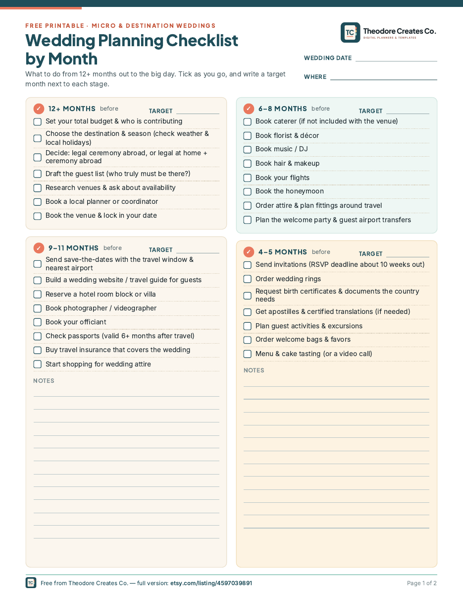
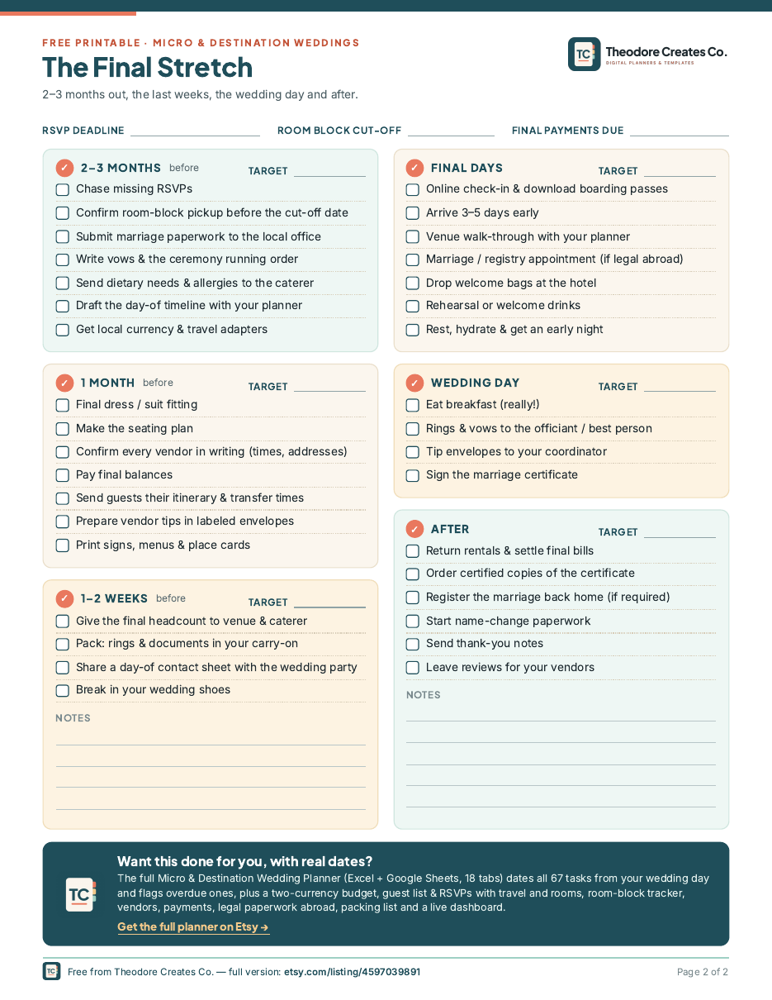

# Free Wedding Planning Checklist by Month (micro & destination weddings)

Free printable + fillable month-by-month wedding planning checklist for micro and destination weddings. 65 tasks from 12+ months out to after the wedding. A4 and US Letter PDFs.

## What's inside
- **Page 1, 12+ months to 4 months out:** 30 tasks in four stages (12+ months, 9–11, 6–8, 4–5), each with a "target" box for your own month, plus notes lines
- **Page 2, the final stretch:** key dates (RSVP deadline, room-block cut-off, final payments), 35 tasks for 2–3 months, 1 month, 1–2 weeks, the final days, the wedding day and after
- Written for small and destination weddings: passports, room blocks, apostilles and translations, guest transfers, tip envelopes in local currency, registering the marriage back home
- Tick boxes and lines you can type into (fillable PDF) or print and write on
- A4 and US Letter sizes

## Download (free)
- [Fillable A4](pdf/Free-Wedding-Planning-Checklist-by-Month-FILLABLE-A4.pdf)
- [Fillable US Letter](pdf/Free-Wedding-Planning-Checklist-by-Month-FILLABLE-US-Letter.pdf)
- [Print A4](pdf/Free-Wedding-Planning-Checklist-by-Month-PRINT-A4.pdf)
- [Print US Letter](pdf/Free-Wedding-Planning-Checklist-by-Month-PRINT-US-Letter.pdf)

> **Tip:** click a link, then press the **Download raw file** button (the ⬇ icon at the top right of the file view). Open fillable PDFs in Adobe Acrobat Reader, or a PDF app on your tablet, so the fields work.

## How to use
1. Download the fillable PDF and open it in Adobe Acrobat Reader (free) or your tablet's PDF app, or print the PRINT version at "Actual size".
2. Write your wedding date at the top, then a target month next to each stage.
3. Tick tasks as you go. Anything that doesn't apply to you, just skip.

## Want the full version?
This is a free sample from the **[Micro & Destination Wedding Planner](https://www.etsy.com/listing/4597039891)** (Excel + Google Sheets, 18 tabs). It dates all 67 checklist tasks from your wedding day and flags overdue ones, and adds a two-currency budget, guest list & RSVPs with travel and rooms, a room-block tracker, vendors, payments, legal paperwork abroad, packing list and a live dashboard.

More printable and digital planners: **[Theodore Creates Co. on Etsy](https://www.etsy.com/shop/TheodoreCreatesCo)**

## License
Free for personal use. Licensed under [CC BY-NC-ND 4.0](https://creativecommons.org/licenses/by-nc-nd/4.0/). Share the link freely, but please don't resell, edit or rehost the files. See [LICENSE](LICENSE).
